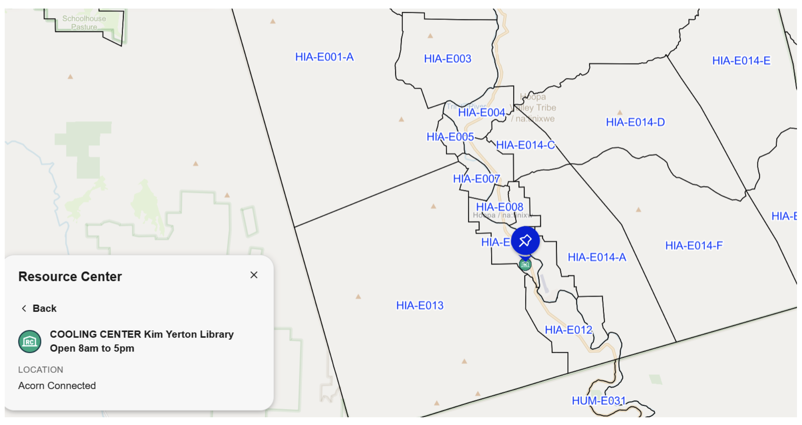
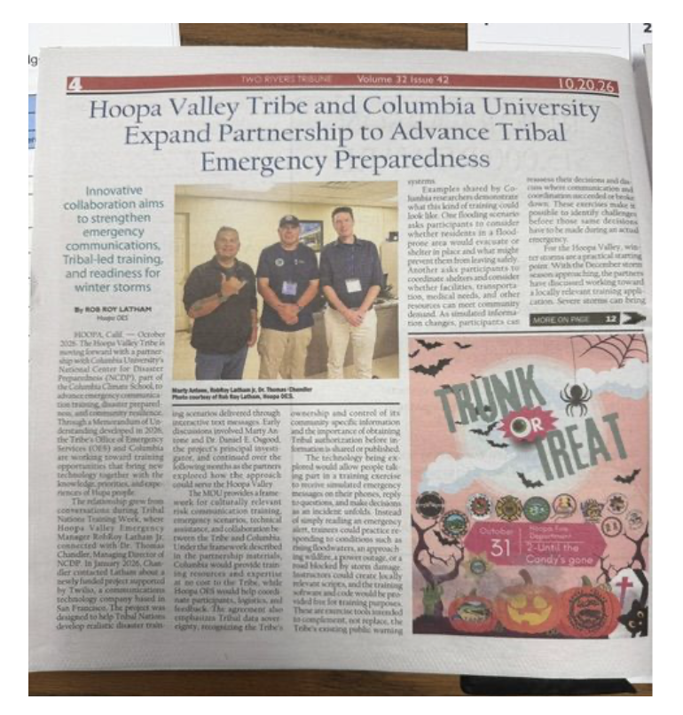

# Hoopa Valley Facility Network

During an emergency, the system coordinates staging and respite across five key facilities:

| Hoopa Facility | Location | Emergency Staging Role |
| :--- | :--- | :--- |
| **Community Center** | 11860 State Hwy 96 (Agency) | Central Red Cross shelter & supply hub |
| **K'ima:w Medical Center** | 535 Airport Rd | Medical triage & critical device power |
| **Kim Yerton Library** | 370 Loop Rd | Daytime warming & clean-air respite |
| **Hoopa School Gyms** | Loop Rd / Central Valley | High-capacity congregate evacuation |
| **Willow Creek** | 8 miles off territory | Alternative option with additional capacity |

<iframe
  src="[https://twowaydisplay.streamlit.app?game=Coordinate&view=all&present=1](https://twowaydisplay.streamlit.app?game=Coordinate&view=all&present=1)"
  title="Live Site Preview"
  width="100%"
  height="600"
  style="border: 1px solid #ccc; border-radius: 6px;"
  loading="lazy">
</iframe>

## Regional Replication & GitHub Deployment

This framework is built to be adapted and self-hosted by neighboring Tribal Nations:
	- **Multi-hazard ready:** Customize the SMS scripts for wildfires, floods, or other regional emergencies.
	- **Local landmarks & language:** Swap in local road names, shelter locations, and Tribal audio recordings.
	- **Inter-Tribal mutual aid:** Share operational lessons across Yurok, Karuk, and neighboring communities.
	- **Self-hosted on GitHub:** Fork the open-source codebase and connect your own SMS phone line.

## Try the Demo & Get Involved

Bring two-way SMS readiness exercises to your Nation:
	- **Test live keywords:** Text the demo line at **+1 (646) 217-0881**
	- **Explore the open code:** at [columbia-desdr.github.io](columbia-desdr.github.io)
	- **Contact the team:** Reach out to **daniel.osgood@columbia.edu** at the National Center for Disaster Preparedness

