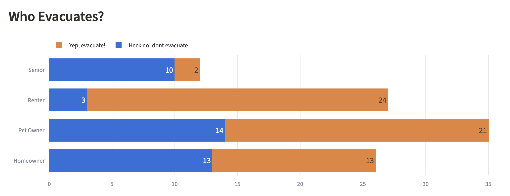

# Interactive Exercise: Four SMS Simulations

The interactive exercise uses **four coordinated SMS simulations** to test live triage, peer-prediction empathy, and shelter staging before winter storms hit:

| Step & Keyword | Focus Area | Function |
| :--- | :--- | :--- |
| **01 • `HVTstorm`** | **Storm Memory** | Paints the picture of past storm impacts at the Hoopa Valley Tribe. |
| **02 • `HVTalert`** | **Live Crisis Routing** | Branches rescues, sandbags, and volunteers during an active event. |
| **03 • `HVTsafe`** | **Discrete Discussions** | Surfaces unspoken evacuation barriers anonymously. |
| **04 • `HVTcoordinate`** | **Resource Staging** | Aligns generators, shelters, and supply hubs. |

## Exercise 1: Community Storm Memory (`HVTstorm`)

This simulation gathers historical storm experiences from both residents and responders to identify real-world case studies and community needs:
	- **Community Experiences:** Residents share past challenges—such as unreachable grocery stores, power loss, and missing emergency updates—alongside community support efforts like sharing firewood, shoveling driveways, and checking on neighbors on foot.
	- **Responder Actions & Hazards:** Government and Tribal responders document past actions (plowing, sanding roads, clearing trees, opening warming shelters) and recurring hazards like downed power lines, active mudslides, and black ice.

## Exercise 2: Active Blizzard & Travel Ban (`HVTalert`)

During an active emergency, `HVTalert` automates live triage by routing residents based on their immediate situation:

| Initial Reply | Automated Follow-Up Questions | OES Action Output |
| :--- | :--- | :--- |
| **1. My home is impacted** | Landmark, headcount, oxygen/wheelchair needs, 4x4 access | Priority rescue dispatch list |
| **2. I need resources** | Specific resources needed, transport access | Resource and staging dispatch |
| **3. I have information or resources** | Wellness check, hazard report, community resource offer | Verified situational map or volunteer pool |

## Exercise 3: Safe Space for Challenging Discussions (`HVTsafe`)

Evacuation decisions are rarely simple. `HVTsafe` creates an anonymous space for residents to discuss tough household dilemmas—such as leaving animals behind, guarding homes, or caring for Elders. Using peer-mirror scoring, participants guess how their neighbors responded to help break feelings of isolation, while an anonymous community board surfaces practical solutions for Tribal planners.

*(Note: Pilot exercise data exploring how household roles shape evacuation willingness is featured in the accompanying presentation charts.)*

<iframe
  src="https://twowaydisplay.streamlit.app/?game=Coordinate&amp;view=all&amp;present=1&amp;embed=true"
  width="100%"
  height="650"
  style="border: none;">
</iframe>

## Exercise 4: Three-Track Resource & Shelter Engineering (`HVTcoordinate`)

To align logistics across the entire community, `HVTcoordinate` runs three simultaneous tracks:
	- **Track 1 (Residents):** Maps household valley sectors, medical power dependencies, and endurance limits.
	- **Track 2 (Providers):** Audits facility generator fuel supplies and staffing bottlenecks.
	- **Track 3 (Leadership):** Evaluates central hub staging versus decentralized sector supply caches.

 

