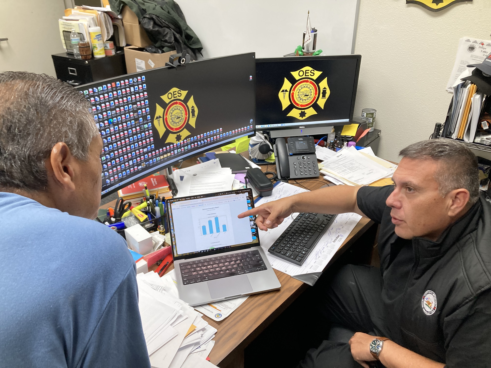

# **The Communication Shift: From Broadcasting to Listening**

Existing emergency systems rely on one-way alerts that broadcast information without knowing who actually needs help. But most communication devices, and many systems already in place can not only send, but can also recieve.  There may be major benefits to using those technologies to shift the focus from broadcasting orders to listening by using thoughtful two-way SMS structured conversations that might be focused enough to work with limited cell signal

We want to discuss with you how you might be able to unlock opportunities using two way disaster communications.

| One-Way Alerts (Already Exist) | Two-Way SMS (New Opportunity) |
| :--- | :--- |
| **Zero feedback:** Responders may not know who needs rescue. Community may not know what to do or where to go | **Live triage:** Residents voice their own needs directly. |
| **Outside messengers:** Generic alerts often face low local trust. | **Trusted and Trustworthy Tribal voice:** Use local landmarks and Tribal protocols. |
| **Bandwidth heavy:** Lots of extra searching for how and who to communicate with-Web links may fail during severe outages. | **1-bar resilience:** Thoughtful, pre-planned Plain SMS. |
| **Siloed systems:** Tribal and state data can be disconnected. | **Shared picture:** Connects Elders, field crews, and OES working together. |

## Think about how you might use two way communication in Disasters

## Hoopa Valley Operational Reality

Emergency planning in Hoopa Valley must account for steep canyon geography and winter isolation:

- **Severed travel routes:** Landslides and fallen trees frequently block Highway 96 and Bald Hills Road.
- **Extended power loss:** Multi-day PG&E outages threaten home heating and critical medical oxygen devices.
- **Rural addressing:** Many households rely on local landmarks and mile markers rather than standard street addresses.

 

